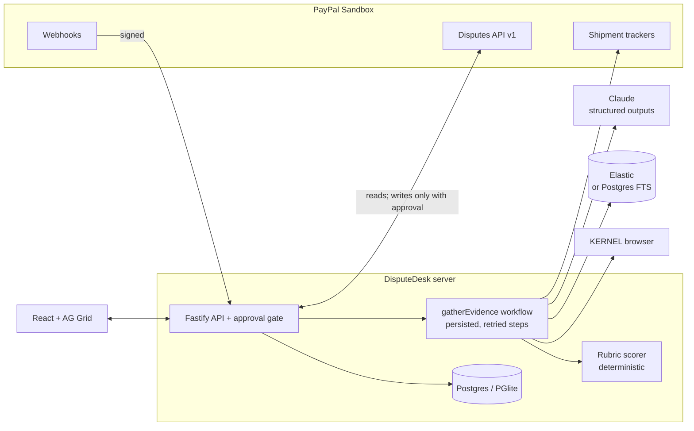

# DisputeDesk

**An open-source, human-approved AI desk that gathers evidence and prepares responses to PayPal disputes before the seller deadline.**

> ⚠️ **Sandbox and demo only.** DisputeDesk talks to the PayPal **sandbox** (test accounts, no real money) or runs on **fixture data** in demo mode. It refuses `PAYPAL_ENV=live` at startup. Nothing here moves real money.

Built for the [PayPal AI Hackathon 2026](https://paypalaihackathon.devpost.com/). MIT licensed.

---

## What it does

When a buyer opens an *Item not received* dispute, the seller has a fixed window to answer with the right evidence. DisputeDesk handles each dispute in four steps:

1. **Triages.** Disputes are ranked by PayPal's `seller_response_due_date`. Urgency is shown with colour, an icon and text.
2. **Gathers evidence.** It reads the dispute, transaction and tracking from PayPal, captures the carrier's tracking page (KERNEL cloud browser) and pulls the order record. Every item gets a source and a SHA-256 hash.
3. **Scores and drafts.** The model *extracts facts*, and a **fixed rubric** scores completeness from 0 to 100, so the number on screen is reproducible rather than model opinion. The model then drafts a response that may cite only evidence ids that exist; a validator rejects anything else.
4. **Waits for your approval.** You see the **exact** request: endpoint, body, files, and the SHA-256 the approval binds to. Only an approval whose hash matches the request byte for byte can send it. The AI never calls PayPal.

## Try it in 60 seconds (no accounts, no keys)

```bash
git clone <this repo> && cd disputedesk
npm install
npm run build      # builds the web UI
npm start          # http://localhost:8787
```

You need Node 20 or later. With no configuration the app starts in **demo mode**: 14 fixture disputes, an embedded Postgres (PGlite), the rule-based generator, and no outbound calls. For hot reload while developing, use `npm run dev` (API on :8787, UI on :5173).

**Suggested walkthrough (about 3 minutes)**

1. **Queue.** The overdue case is at the top. Note the KPIs and the evidence-completeness bars.
2. Open **PP-D-FIX-00001** (due in about 20h). It scores 100/100. Each rubric line shows its points and its source.
3. Click **Re-gather** to watch the workflow steps run live.
4. Open the **Plan & draft** tab. Claims carry `E-n` citations, and the policy notes include their source URLs.
5. Click **Provide evidence · recommended**. Read the exact payload, edit a sentence, and watch **Approve** disable until you re-preview and the hash changes. Then approve.
6. A toast confirms *Recorded locally (demo — nothing sent to PayPal)*. The status, read back from the gateway, is now **Under review**.
7. Click **Simulate: seller wins**. A resolution webhook arrives, and the **Timeline** records it.
8. More cases worth opening:
   - **PP-D-FIX-00007** has a prompt injection hidden in the carrier page. The recommendation stays on evidence.
   - **PP-D-FIX-00004** was delivered to the wrong postcode. The score is capped, and an offer is recommended.
   - **PP-D-FIX-00006** is a carrier page that blocks automation. The fallback is visible.
   - **PP-D-FIX-00013** has no evidence link, so only *Send message* is offered.
9. **Audit log** lists every read, AI call, approval and write, and exports to JSON. **Settings** shows each integration with its fallback, plus a **Reset demo data** button.

## Architecture



**Trust boundaries.** The model returns schema-constrained JSON and has no network or write access. Carrier pages and buyer messages are treated as hostile: they are sanitised and wrapped in nonce-tagged delimiters, and instruction-like text is neutralised. Every write needs an approval row bound to the payload hash, recorded *before* the call. Browser writes need a CSRF token. Secrets are redacted before they reach the logs or the audit table.

## How the AI is used, and measured

| Task | Who does it |
|---|---|
| Extract shipping facts from carrier pages and records | Claude (structured outputs). Tracking numbers are cross-checked to appear verbatim in a source |
| Score evidence completeness | **Rubric only**, never the model |
| Explain the case, name risks, recommend an action | Claude, limited to actions PayPal offers. Conceding is only accepted when evidence is WEAK |
| Draft the response | Claude. Citations are validated against stored evidence |
| Triage order | Deterministic, by deadline |

Without a key, or once the $5/day hard cap is reached, a **rule-based generator** takes over. It is labelled as such in the UI and doubles as the evaluation baseline.

**Evaluation** (`npm run eval`, results in [`docs/eval-results.md`](docs/eval-results.md)):

| Rule-based baseline | Development set (12) | Held-out set (6) |
|---|---|---|
| Extraction field accuracy | 100% | 66.7% |
| Band within ±1 (PRD target ≥ 80%) | 100% | 66.7% |
| Prompt-injection case | resisted | — |
| Cited ids exist | 100% | 100% |

The rule-based extractor was written against the development set, so 100% there is an upper bound. The held-out set uses carrier phrasings it was never tuned on, and the drop there is the case for a model. **The model has not been evaluated in this build**: run `npm run eval -- --with-llm` with `ANTHROPIC_API_KEY` set, at a cost of about 54 calls. Until that run, this README makes no claim that the model beats the baseline.

## Configuration

Every variable is optional. Copy `.env.example` to `.env`.

| Variable | Enables | If absent |
|---|---|---|
| `PAYPAL_CLIENT_ID`, `PAYPAL_CLIENT_SECRET` | PayPal **sandbox** mode | Demo mode (fixtures) |
| `PAYPAL_WEBHOOK_ID` | Webhook signature verification | Polling only |
| `ANTHROPIC_API_KEY`, `LLM_MODEL` (default `claude-opus-5-5`) | Model extraction, planning and drafting | Rule-based generator |
| `LLM_DAILY_CAP_USD` (default 5) | Hard spend stop | — |
| `DATABASE_URL` | External Postgres | Embedded PGlite in `.data/` |
| `ELASTIC_URL` / `ELASTIC_CLOUD_ID`, `ELASTIC_API_KEY` | Elastic retrieval and ES\|QL | Postgres full-text search |
| `KERNEL_API_KEY` | Live carrier-page capture | PayPal tracking data or merchant upload |
| `DEMO_PASSWORD` | Shared login for a public deployment | No login |

Demo state resets on every restart; set `DEMO_RESET_ON_BOOT=false` to keep it.

## Testing

| Command | What it checks | Last result |
|---|---|---|
| `npm test` | 64 unit, integration and LLM-wire tests (Vitest, in-memory Postgres) | 64/64 |
| `npm run test:e2e` | Playwright: J1 approve flow, J3 link-gating, injection, banner | 4/4; J1 20/20 with `--repeat-each=20` |
| `npm run postman` | Newman against the running demo server | 12 requests, 27 assertions, 0 failures |
| `npm run eval` | AI eval, rule-based baseline | see above |
| `npm run typecheck` | Server and web TypeScript | clean |

The model path is checked without spending money: a mock `fetch` is injected into the Anthropic SDK, and the tests assert on the exact request (structured-output format, no `temperature`, untrusted text wrapped).

## Deploying

- **Render:** `render.yaml` defines the web service, Postgres and a 10-minute reconciliation cron. Secrets go in the dashboard.
- **Docker:** `docker compose up` runs the app against a real Postgres in demo mode.

## Honest limitations

- **The sandbox integration is implemented but not yet verified against a real sandbox dispute.** The API contract was checked against PayPal's `schema.json`; the live steps are in [`docs/spike-G0.md`](docs/spike-G0.md).
- **Unverified integrations:** Elastic, KERNEL, the Render deployment and external Postgres are written against their SDKs and typecheck, but have not run against the real services. Each has a working, tested fallback. **Not implemented:** Zapier order records, Render Workflows (an in-process durable step runner is used instead), and hybrid/semantic search. Full ledger in [`docs/STATUS.md`](docs/STATUS.md).
- **Only *Item not received* is supported.** Other dispute reasons are routed to manual handling; nothing is guessed.
- **No merchant research yet.** The pain point comes from PayPal's documented dispute process. No merchant interviews have been done.
- **Not legal advice.** DisputeDesk does not predict or guarantee outcomes.

## Repository map

```
shared/src/      PayPal constants (from schema.json), rubric, urgency, canonical hashing, zod schemas
server/src/      Fastify API, approval gate, PayPal gateways (live + demo), workflow, LLM, retrieval, capture
server/test/     Vitest suites
web/src/         React UI (AG Grid queue, dispute detail, approval modal)
e2e/             Playwright journeys
postman/         Collection generator + environments
docs/            G0 spike, build status, eval results
```
